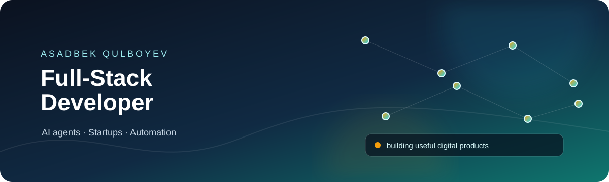
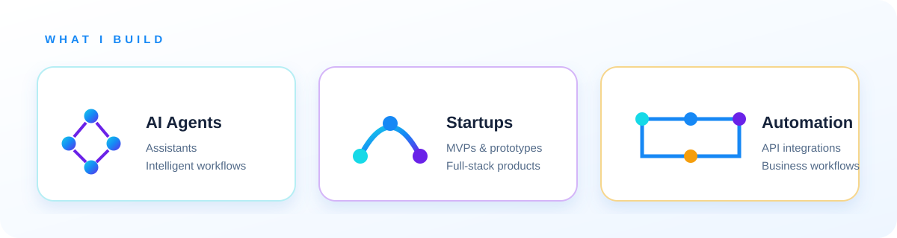
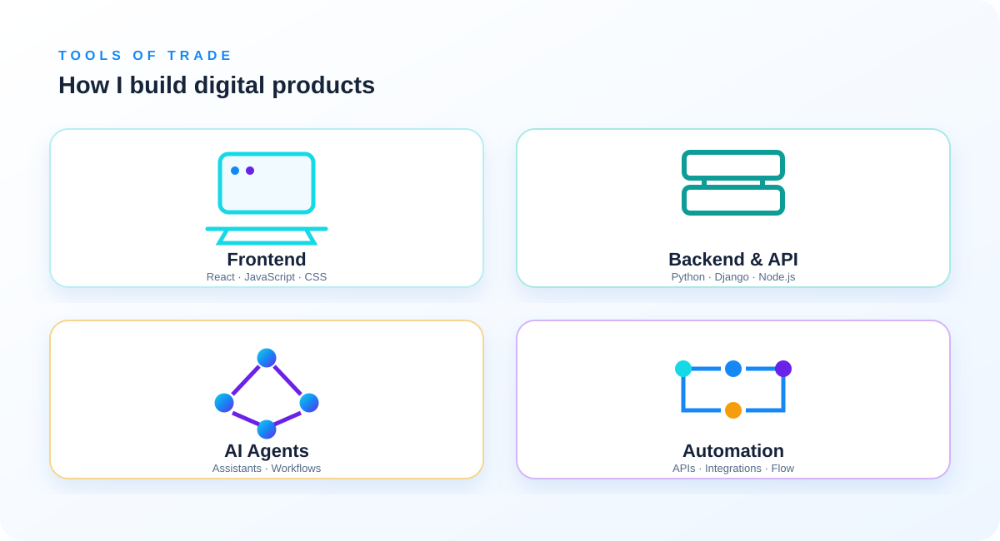

<a href="https://github.com/asadbekqulboyev">GitHub</a> · <a href="https://www.linkedin.com/in/asadbek-qulboyev-091047260/">LinkedIn</a> · <a href="https://www.instagram.com/asadbekqulboyev/">Instagram</a> · <a href="https://www.youtube.com/@front_ment">YouTube</a>

<strong>AI Agents</strong> · <strong>Startups</strong> · <strong>Automation</strong>

<strong>Frontend</strong> · <strong>Backend &amp; API</strong> · <strong>AI Agents</strong> · <strong>Automation</strong>

## Connect

[LinkedIn](https://www.linkedin.com/in/asadbek-qulboyev-091047260/) · [Instagram](https://www.instagram.com/asadbekqulboyev/) · [YouTube](https://www.youtube.com/@front_ment)
